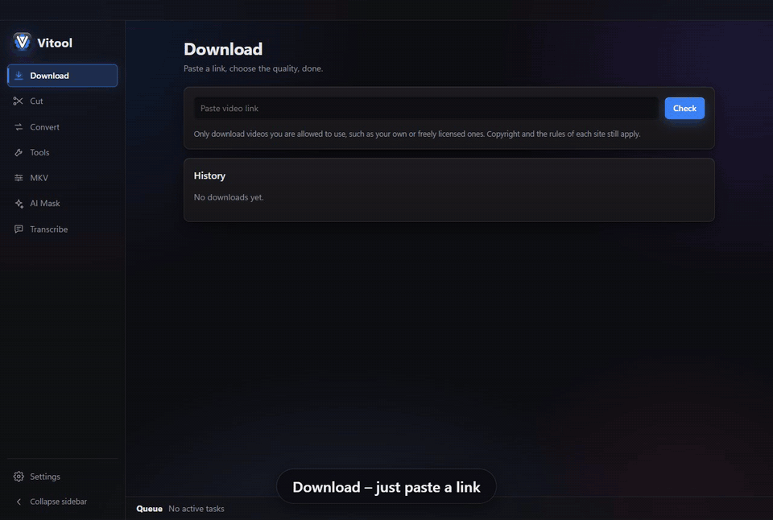
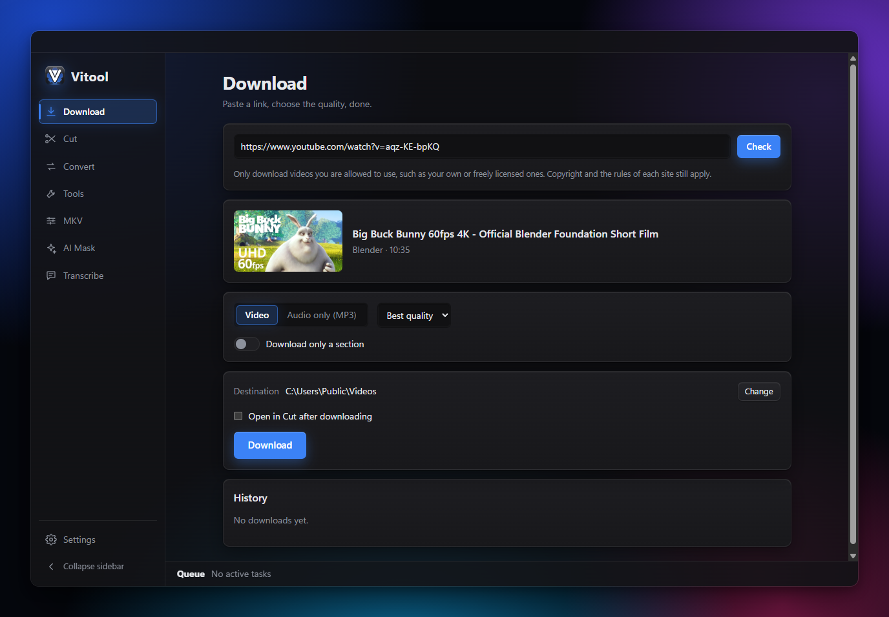
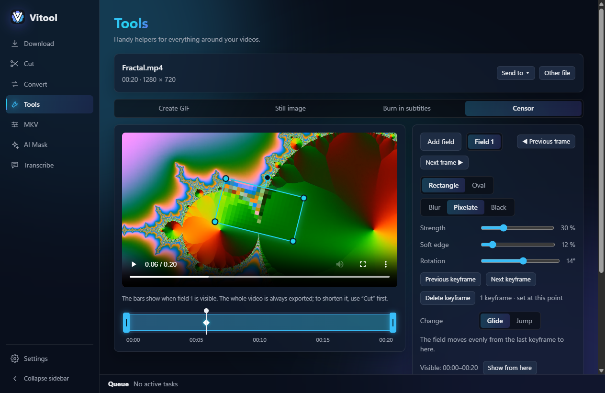
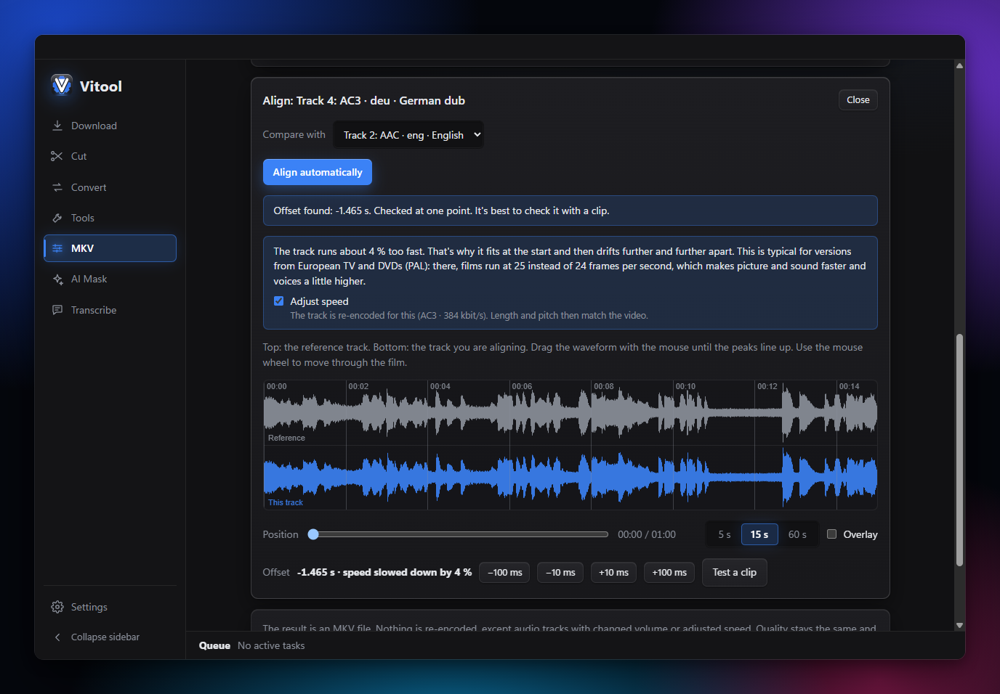
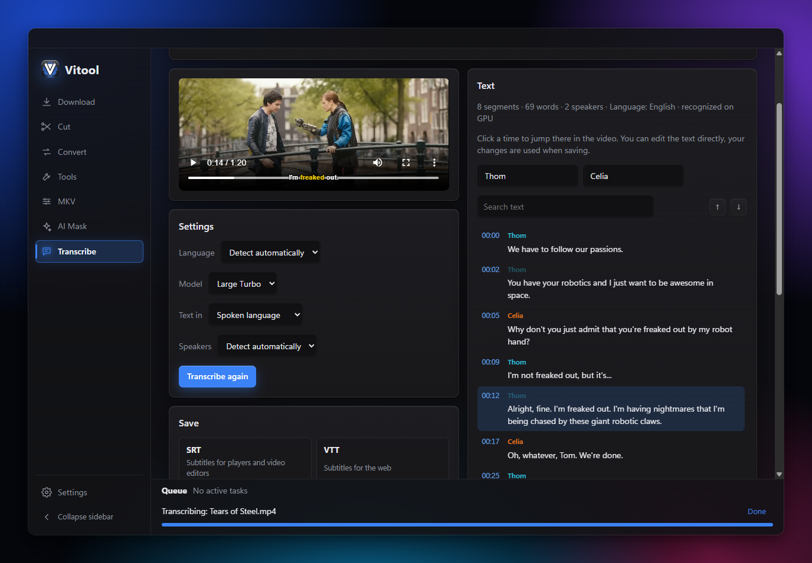
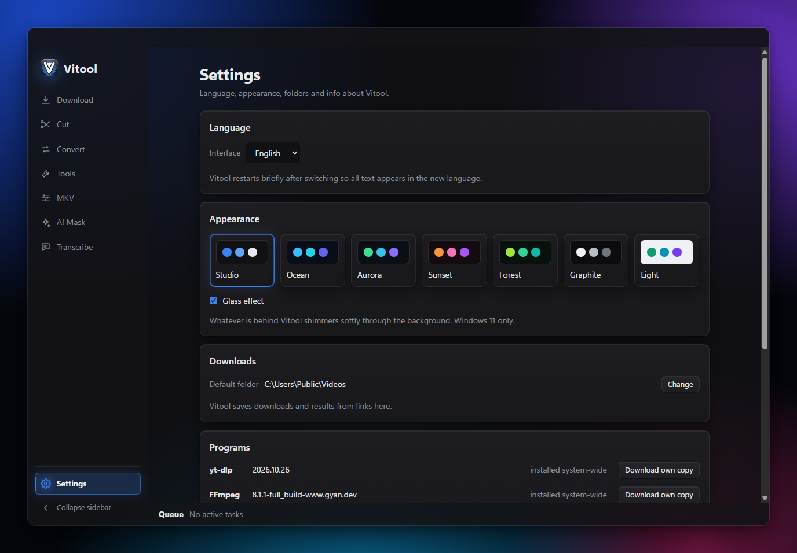

<p align="center">
  
</p>

<h1 align="center">Vitool</h1>

<p align="center">
  An all-in-one video toolbox for Windows: download, cut, convert, censor, mask and transcribe.<br>
  Everything runs on your own computer. Nothing is uploaded.
</p>

<p align="center">
  <a href="https://github.com/bioheater/Vitool/releases/latest"><b>Download for Windows</b></a>
  ·
  <a href="#features">Features</a>
  ·
  <a href="#license">License</a>
</p>



## Features

### Download
- Paste a link from YouTube, Instagram, TikTok and many other sites, pick the quality, done
- Audio only, single sections of a video, or whole playlists
- If yt-dlp doesn't know a site, Vitool opens the page in its own window and downloads the video you play there
- yt-dlp keeps itself up to date, and an optional YouTube sign-in helps with age-restricted or private videos
- Download history with quick access to your files



### Cut
- Lossless cuts in seconds, or frame-exact cuts when precision matters
- Several sections at once, saved separately or joined into one file

### Convert
- MP4, MKV, WebM, MP3, WAV and more
- Target size, for example under 25 MB for sending
- Many files or a whole folder at once

### Tools
- Create GIFs and save still images
- Extract the audio track
- Burn SRT, ASS or VTT subtitles into the picture
- **Censor**: blur, pixelate or black out areas with moving, resizable and rotatable fields.
  Keyframes for position, size, strength and rotation, soft edges, several visible
  sections per field, and a choice between gliding and jumping between keyframes



### MKV
- Remove unneeded audio tracks and subtitles without re-encoding
- Set language, name, default and forced flags
- Add tracks or save them as separate files
- **Align audio tracks**: Vitool finds the offset of a dub by itself and also fixes PAL versions
  that slowly drift apart
- Match a quiet track to the original volume, or make it louder or quieter by hand
- Shift audio and subtitle tracks by a few seconds



### AI Mask (optional add-on)
- Click an object, the AI finds its shape and tracks it through the video (SAM 2.1 by Meta)
- Blur the object or the background, or cut it out

### Transcribe (optional add-on)
- Speech recognition with Whisper, also straight from a link
- Tells speakers apart (pyannote), rename them and fix mistakes with a click
- Translate any language into English
- Save as SRT, VTT, text or JSON, or burn styled subtitles into the video
- Transcribe many files or a whole folder in one go



### And also
- Seven color themes with a subtle glass effect on Windows 11, English and German interface
- Send a file from one area to the next, for example from Download to Cut
- Updates from GitHub with one click in the settings



## Installation

1. Download `Vitool-Setup-x.y.z.exe` from the [latest release](https://github.com/bioheater/Vitool/releases/latest).
2. Run it. Windows may show **"Windows protected your PC"** because the installer is not code-signed yet.
   Click **More info** and then **Run anyway**.
3. On first start, Vitool offers to set up the programs it needs (yt-dlp, FFmpeg and Deno, about 270 MB).
   It downloads them from their official releases, checks them and keeps them in its own folder.
   If you prefer, you can install them yourself with winget instead.

**Requirements:** Windows 10 or 11, 64-bit. An NVIDIA graphics card makes AI Mask and Transcribe much faster,
but they also run on the processor.

The add-ons AI Mask and Transcribe are optional and downloaded only when you set them up inside Vitool.
They bring their own Python, so you do not need to install anything else.

## Privacy

Vitool processes all videos, audio and transcripts locally. It only goes online to download what you ask for,
to set up its programs and add-ons, and to check for updates on GitHub.

## Building from source

You need [Node.js](https://nodejs.org) 20 or newer.

```bash
git clone https://github.com/bioheater/Vitool.git
cd Vitool
npm install
npm start
```

`npm run installer` builds the Windows installer into `dist`.

## Contributing

Bug reports and ideas are welcome as [issues](https://github.com/bioheater/Vitool/issues).
If you would like to contribute code, please read [CONTRIBUTING.md](CONTRIBUTING.md) first.

## License

Vitool is free and open-source software under the [GNU AGPL-3.0](LICENSE).
You may use, change and share it, also commercially. If you share a modified version, including over a network,
you have to make its full source code available under the same license.

The name **Vitool** and the logo are not covered by the AGPL: modified versions need their own name and logo.
Details, the licenses of all third-party components and the required attributions are in
[LICENSE-NOTICE.md](LICENSE-NOTICE.md).

The screenshots show the Blender open movies *Big Buck Bunny* and *Tears of Steel*,
© Blender Foundation ([blender.org](https://www.blender.org)), licensed under
[CC BY 3.0](https://creativecommons.org/licenses/by/3.0/).

## Responsible use

Only download, edit or transcribe content you have the right to use.
Copyright and the rules of the websites you download from still apply.
